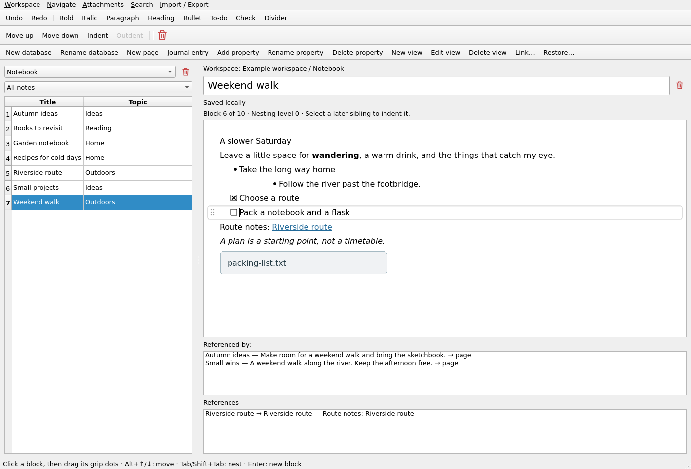
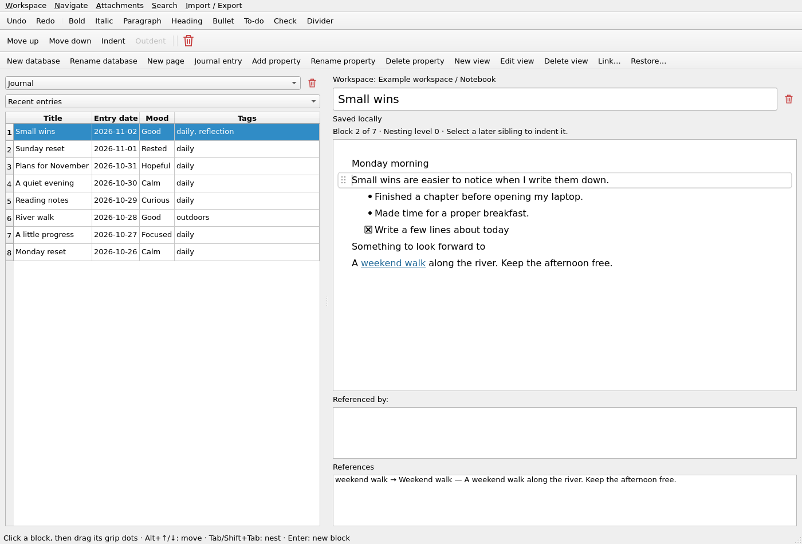
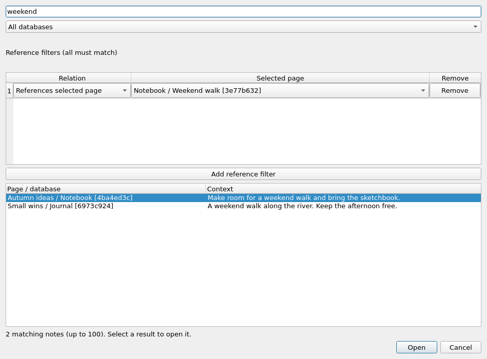

# Nebula

An always-local, single-user note-taking and diary application for Linux.
Databases organize pages with typed properties and flowing, movable blocks.
Local links and backlinks connect notes across databases in one workspace.

Start with the [first-use guide](docs/USER_GUIDE.md). Nebula's source is
[MIT licensed](LICENSE); dependencies retain their own licenses.
Milestones, defects and verification evidence live in [ROADMAP.md](ROADMAP.md).

## Linux packages

Download the [0.1-alpha prerelease](https://github.com/oppenheimmer/nebula/releases/tag/0.1-alpha)
from its **Assets** section:

- [Debian 13 amd64](https://github.com/oppenheimmer/nebula/releases/download/0.1-alpha/nebula-0.1.0.alpha-x86_64.deb)
  — [installation instructions](docs/INSTALL.md).
- [Enterprise Linux 9 x86_64](https://github.com/oppenheimmer/nebula/releases/download/0.1-alpha/nebula-0.1.0.alpha-x86_64.rpm)
  — [EPEL/CRB requirements and installation](docs/RPM.md).

Both packages report `0.1.0~alpha`. GitHub download filenames use `.alpha`;
local builds use `~alpha`. The release includes checksums and build information.
See the [release notes](docs/RELEASE_NOTES.md) for alpha limitations. No AppImage
is available.

Launch an installed package with `nebula` or the application menu.
`nebula --version` and `nebula_workspace --version` work without a display.

## Screenshots

Nebula `0.1-alpha`, using a fictional example workspace.

**Block editing and local links.** Nested lists, tasks, a managed file attachment,
and incoming/outgoing references in one page.



**Diary entries and saved views.** A date-sorted Journal view with entry dates,
moods and tags alongside the selected page.



**Workspace search.** Combine text matching with a reference filter to find
related notes across databases.



[Capture details](assets/screenshots/0.1-alpha/README.md).

## Build with Docker

Use the existing Docker CLI and daemon. Qt and development dependencies stay
inside the project image.

```sh
./scripts/dev.sh build-image
./scripts/dev.sh test gcc
./scripts/dev.sh test clang
./scripts/dev.sh test core
```

Image preparation downloads dependencies. Subsequent builds/tests run offline,
as your numeric user/group, with read-only source and root mounts. Build output
stays in ignored `build-container-*/` directories. The wrapper does not change
Docker settings, socket permissions or user groups.

`./scripts/dev.sh shell` opens a development shell with source at `/workspace`
and writable output at `/build`. Dependency baselines and the project-local SDK
fallback are in [DEPENDENCIES.md](docs/DEPENDENCIES.md).

To build and verify packages in clean Docker runtimes:

```sh
./scripts/package-check.sh deb
./scripts/dev.sh build-rpm-image
./scripts/package-check.sh rpm
```

These commands verify installation, workspace preservation and offline note
operations without installing host packages.

## Run

For an installed package, run `nebula`. From a checkout:

```sh
./scripts/dev.sh run
./scripts/dev.sh run --workspace /path/to/your/nebula
```

The Docker launcher rebuilds the application and asks where to keep the workspace,
suggesting `~/Document/nebula/`. Choose the same folder when reopening.
A workspace contains `nebula.sqlite3`, `attachments/` and coordination lock files.
New workspace folders are private (0700), and database files are 0600. Cancel
leaves the location untouched. Backups and exports must be restored/imported into
a new workspace before opening. Only one process may open a workspace for editing.

The chooser sees your home read-only. The editor receives the selected workspace
as a writable mount at `/data`; `--workspace` can select folders outside your home.
To import files from another host folder:

```sh
./scripts/dev.sh run --import-root /path/to/source-folder
```

That folder appears read-only at `/imports`. The editor does not receive the rest
of your home directory.

The Docker GUI requires X11 or Xwayland: `DISPLAY`, `/tmp/.X11-unix` and a readable
`XAUTHORITY` file (or `~/.Xauthority`). GUI containers share that display socket
and authorization file. Headless checks do not access the host display.
No `xhost +`, privileged mode or host networking is used.

`./scripts/dev.sh run --demo` opens a disposable in-memory sample. Add
`--compare-editors` to inspect the M01 comparison baseline; its separate widgets
have independent selection and undo.

## Edit blocks

Choose a database and select a page's row to edit it. Double-click table cells
to change titles or typed properties. New view/Edit view controls filters,
sorting and columns over the same pages. The Journal database includes Entry
date, Mood and Tags; Journal entry asks which calendar date the entry describes.

A thin outline and subtle shadow identify the active block. Drag its grip dots
to reorder it with its children; drag right to nest, or press Escape to cancel.
Visual wrapping never creates a new paragraph.

| Action | Keyboard or control |
| --- | --- |
| New paragraph / soft line break | Enter / Shift+Enter |
| Bold / italic | Ctrl+B / Ctrl+I |
| Paste plain text | Ctrl+Shift+V |
| Undo / redo | Ctrl+Z / Ctrl+Shift+Z |
| Move a block and its children | Alt+Up/Down or grip dots |
| Nest / unnest | Tab / Shift+Tab |
| Insert a divider | Divider toolbar button |
| Move a subtree to another page | Ctrl+Shift+M |
| Undo / redo the latest block transfer | Ctrl+Alt+Z / Ctrl+Alt+Shift+Z |
| Follow a reference | Ctrl+click or Ctrl+Enter |
| Navigate back / forward | Alt+Left / Alt+Right |
| Read accessible block details | F8 |
| Save immediately | Ctrl+S |

Splitting a parent transfers its children to the trailing block. Backspace at the
start of a nested block outdents it. Adjacent typing shares an undo group until a
pause, navigation or another command. Undo survives autosave on the open page;
it clears on page navigation and does not survive restart.

Attachments → Import image… / Import file… stores a managed copy. Moving or
deleting the original source does not affect it. Open current attachment gives
the desktop handler a read-only copy; Save a copy… exports its bytes.
See [managed files](docs/ATTACHMENTS.md) for retention, preview and recovery rules.

The red trash buttons act on the selected database, open page or active subtree.
Each asks for confirmation. Restore… recovers saved deleted content after restart;
Empty trash permanently… is separate and irreversible. See [trash and recovery](docs/TRASH.md).

Use Link… or type `[[Page]]`, `[[Page#Heading]]` or `[[Page#^block-id]]`.
Links resolve by stable IDs; duplicate names require a target choice. Referenced
by and References show incoming and outgoing links. [Link entry and navigation](docs/LINKS.md)
covers labels, completion, unresolved targets and moves. [Clipboard semantics](docs/CLIPBOARD_FORMAT.md)
explains identity remapping when copying between notes.

Ctrl+Shift+F searches the workspace. Words combine with AND; a trailing `*`
requests a prefix. Reference filters also work without search words. Saved views
combine those filters with typed properties. See [search behavior](docs/SEARCH.md)
and [property/view rules](docs/WORKSPACE_FORMAT.md).

## Pasted web links

Pasting a complete HTTP(S) URL keeps the link and attempts one removable,
text-only preview. Cancel preview stops the request. Successful text is a separate
editable paragraph with its own undo step; opening a note never fetches it again.

The request sends the pasted path/query to that origin, without cookies,
credentials or Referer. Redirects must stay on the same scheme, host and port.
No images or thumbnails are fetched. Failures leave the URL intact.
[PREVIEW_DESIGN.md](docs/PREVIEW_DESIGN.md) documents limits and cancellation.

The normal Docker workspace GUI has network access for this paste action.
Ordinary note operations work offline; builds, tests, the chooser, demo/smoke
runs and data commands use `--network=none`.

## Backup and restore

For an installed package:

```sh
nebula_workspace backup /path/to/workspace /path/to/new-backup
nebula_workspace restore /path/to/new-backup /path/to/new-workspace
```

From a checkout, use `./scripts/dev.sh backup` or `restore` with the same paths.
Choose new destination folders outside the source. Backup copies a consistent
database snapshot and managed attachments; restore verifies their hashes and
creates a fresh workspace. Missing or changed files fail the operation.
The checksum manifest detects corruption, not deliberate tampering.

Material data-handling limits:

- Autosave waits 500 ms. **Saved locally** means persistence succeeded. A failed
  save keeps edits visible; normal close asks whether to retry or discard them.
  Forced termination or power loss can lose pending edits. Handled termination
  signals attempt a save but still exit if it fails.
- Backups must include the database and its managed files. Use the documented
  tool rather than copying a live database alone.
- Lossless JSON preserves the supported model, IDs, trash, recovery and retained
  files. Markdown omits properties, views and recovery history. See
  [JSON interchange](docs/INTERCHANGE.md) and [Markdown conversion](docs/MARKDOWN.md).
- Interrupted exports can retain a private full-workspace scratch database,
  including data omitted from Markdown. Remove incomplete exports before sharing.

Docker data commands mount the source read-only and write through a private staging
folder. They refuse uncommitted source changes unless `NEBULA_ALLOW_DIRTY=1` is set.
Persistence, migrations and undo boundaries are documented in
[WORKSPACE_FORMAT.md](docs/WORKSPACE_FORMAT.md).

## Checks and measurements

```sh
./scripts/dev.sh test asan
./scripts/dev.sh fuzz 30
./scripts/dev.sh format --check
./scripts/dev.sh stress 20
./scripts/dev.sh test-native
./scripts/dev.sh build-desktop-image
./scripts/dev.sh test-desktop
./scripts/dev.sh run --smoke-test
./scripts/dev.sh run --screenshot /build/prototype.png
./scripts/dev.sh benchmark single
./scripts/dev.sh benchmark separate
./scripts/dev.sh benchmark workspace
```

GCC/Clang tests cover the core, storage, editor, application window and launch;
ASan adds AddressSanitizer/UndefinedBehaviorSanitizer. Fuzzing exercises parsers,
and stress repeats interaction suites. Logs, corpora and screenshots stay in
ignored build directories. Formatter commands require a Git checkout.

`test-native` uses the host X11/Xwayland display. `test-desktop` uses a private
Xvfb/Openbox desktop with IBus/Anthy and Orca/AT-SPI, without host display, audio
or session-bus access. [Dependency profiles](docs/DEPENDENCIES.md) describe isolation.

The workspace benchmark covers 10,000 blocks, 5,000 Journal entries, 1,200
referrers and 200 images. [PERFORMANCE.md](docs/PERFORMANCE.md) defines fixtures
and budgets. GitHub's [checks workflow](https://github.com/oppenheimmer/nebula/blob/main/.github/workflows/ci.yml) runs the Docker
validation. Project conventions are in [AGENTS.md](AGENTS.md).
